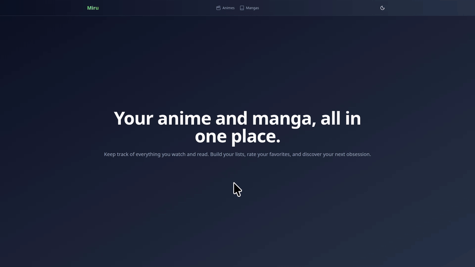

# Miru

Miru é um aplicativo para acompanhar os animes e mangás que você assiste e lê, com listas personalizadas, notas e
descoberta de novos títulos.



## Tecnologias

- **Frontend:** Nuxt.js
- **Backend:** ASP.NET Core
- **Banco de dados:** PostgreSQL
- **Infraestrutura:** Docker

## Instalação

```shell
git clone https://github.com/hzokbe/miru.git

cd miru
```

Crie os arquivos de ambiente:

```shell
cp .env.example .env

cp client/.env.example client/.env
```

## Execução

Suba todos os serviços (banco de dados, servidor e client):

```shell
docker compose up -d --build
```

A aplicação ficará disponível em `http://localhost:3000`.

## Variáveis de ambiente

| Variável                | Descrição                                          | Padrão               | Arquivo       |
|-------------------------|----------------------------------------------------|----------------------|---------------|
| `DB_USERNAME`           | Usuário do PostgreSQL                              | `miru`               | `.env`        |
| `DB_PASSWORD`           | Senha do PostgreSQL                                | `miru`               | `.env`        |
| `DB_DATABASE`           | Nome do banco de dados                             | `miru`               | `.env`        |
| `DB_PORT`               | Porta do PostgreSQL exposta no host                | `5432`               | `.env`        |
| `NUXT_API_INTERNAL_URL` | URL interna da API, usada pelo servidor Nuxt (SSR) | `http://server:8080` | `client/.env` |
| `NUXT_PUBLIC_API_URL`   | URL pública da API, usada pelo navegador           | `/api`               | `client/.env` |

## Desenvolvimento

Para executar o servidor e o client fora do Docker, suba apenas o banco de dados:

```shell
docker compose up -d db
```

Inicie o servidor:

```shell
cd server

dotnet run
```

Em outro terminal, inicie o client:

```shell
cd client

npm i

npm run dev
```

## Licença

Este projeto está licenciado sob a licença MIT. Consulte o arquivo [LICENSE](LICENSE) para mais detalhes.
